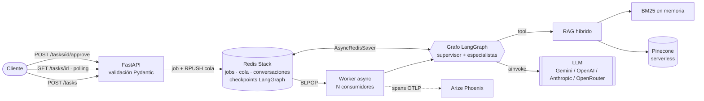
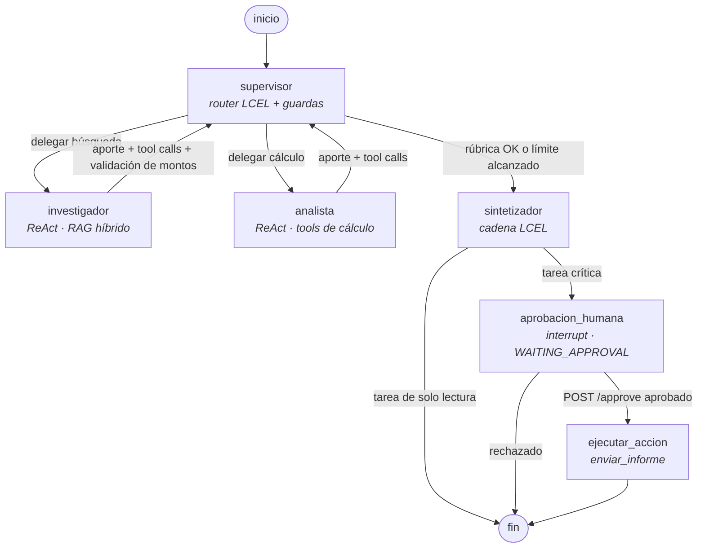
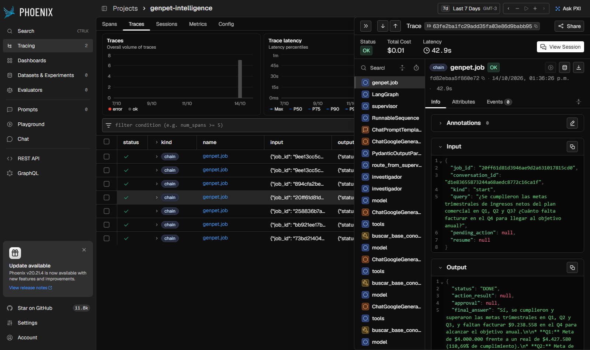

# GenPet · Intelligence System

Sistema multi-agente de grado producción que responde preguntas de negocio sobre la base documental de
**GenPet** (ventas, finanzas, plan comercial, políticas y productos). Un **supervisor** descompone la consulta y
delega en un **investigador**, que recupera datos con un **RAG híbrido** (BM25 + Pinecone con filtros de
metadatos y fusión RRF), y en un **analista**, que hace cada cálculo con herramientas. Después un **sintetizador** redacta la
respuesta citando las fuentes. Todo corre **async** detrás de una **API FastAPI** con cola en **Redis**. Las
conversaciones persisten con el **checkpointer de LangGraph**, cada ejecución queda trazada en **Arize Phoenix**
y las acciones irreversibles (enviar el informe por mail) esperan **aprobación humana**.

```bash
./run.sh          # = docker compose up -d --build  → API en :8000/docs · trazas en :6006
```

---

## Contenido

1. [Arquitectura en 5 minutos](#1-arquitectura-en-5-minutos)
2. [Diagrama del grafo de agentes](#2-diagrama-del-grafo-de-agentes)
3. [Puesta en marcha](#3-puesta-en-marcha)
4. [Uso de la API](#4-uso-de-la-api)
5. [De dónde sale cada pieza (Módulos 1 a 7)](#5-de-dónde-sale-cada-pieza-módulos-1-a-7)
6. [RAG híbrido y su evaluación](#6-rag-híbrido-y-su-evaluación)
7. [Persistencia y memoria conversacional](#7-persistencia-y-memoria-conversacional)
8. [Validación con Pydantic en cada frontera](#8-validación-con-pydantic-en-cada-frontera)
9. [Observabilidad: las 5 pruebas con trazas](#9-observabilidad-las-5-pruebas-con-trazas)
10. [Decisiones de arquitectura](#10-decisiones-de-arquitectura)
11. [Tests](#11-tests)
12. [Configuración](#12-configuración)
13. [Checklist de la consigna](#13-checklist-de-la-consigna)

---

## 1. Arquitectura en 5 minutos



- **La API nunca ejecuta el grafo.** `POST /tasks` valida, clasifica si la tarea es crítica, crea el job y lo
  encola en una transacción de Redis, y responde `202` en milisegundos. Un worker (proceso aparte en Docker)
  consume la cola y ejecuta el grafo. Como el estado vive en Redis, la API y el worker escalan por separado.
- **El grafo es jerárquico.** El supervisor decide (salida estructurada Pydantic) y los especialistas reportan
  siempre al supervisor, nunca entre sí. Cada especialista tiene solo sus herramientas: el investigador busca,
  el analista calcula.
- **No se confía en el LLM para lo crítico.** Hay guardas deterministas (tope de delegaciones, validación de
  montos contra las fuentes, recálculo si llegan datos nuevos), salidas validadas con Pydantic y aprobación
  humana obligatoria antes de cualquier efecto secundario.
- **Todo es async de punta a punta:** FastAPI, `redis.asyncio`, `AsyncRedisSaver`, `AsyncPinecone`,
  `aembed_query`, `ainvoke` de los modelos y tools `async def`. Lo único CPU-bound (BM25) corre en
  `asyncio.to_thread`. No hay `requests` ni `time.sleep` en el código.

## 2. Diagrama del grafo de agentes



El diagrama exportado del grafo compilado está en [`docs/graph.mmd`](docs/graph.mmd) y
[`docs/graph.png`](docs/graph.png) (se regenera con `python -m scripts.export_diagram`).

| Nodo | Responsabilidad | Ve | Herramientas |
|---|---|---|---|
| `supervisor` | Decide el próximo paso con una rúbrica (cobertura, trazabilidad, cómputo verificado, consistencia). Guardas deterministas pisan al LLM si hace falta. | Historial de la conversación, consulta, aportes con su registro real de tool calls, presupuesto restante | — |
| `investigador` | Obtiene datos. Copia cifras literales y marca REAL / META. Un validador determinista verifica que cada monto exista en las fuentes. | Su instrucción y sus aportes previos | `buscar_base_conocimiento` (RAG híbrido, filtro por categoría), `listar_documentos`, búsqueda web opcional |
| `analista` | Calcula variaciones, cumplimiento de metas y estadísticas. Nunca hace cuentas "de cabeza". | Datos del investigador y sus aportes previos | `calcular` (AST seguro), `variacion_porcentual`, `cumplimiento_de_meta`, `estadisticas_descriptivas` |
| `sintetizador` | Redacta la respuesta final con reglas de resolución de conflictos y cita las fuentes. | Historial, consulta y aportes | — |
| `aprobacion_humana` | `interrupt()`: pausa el grafo, el checkpoint queda en Redis y se reanuda con `Command(resume=...)` | Borrador del informe | — |
| `ejecutar_accion` | Ejecuta la acción ya aprobada (bandeja de salida en Redis) | — | `enviar_informe` |

**Condiciones de parada:** máximo 6 delegaciones por turno, máximo 3 intervenciones por especialista, 12 pasos
por loop ReAct interno, `recursion_limit` de LangGraph y timeout por job. Si el router devuelve una salida
inválida, se sintetiza lo disponible. Si hay un error de infraestructura (API, red, créditos), el job pasa a
`FAILED` con el motivo: nunca se disfraza de respuesta.

## 3. Puesta en marcha

Requisitos: Docker con `docker compose`. Para correr fuera de Docker: Python 3.12+.

```bash
cp .env.example .env      # completar GEMINI_API_KEY y PINECONE_API_KEY (run.sh lo crea si falta)
./run.sh                  # construye y levanta redis + phoenix + api + worker; espera al /health
```

| Servicio | URL |
|---|---|
| API (Swagger / OpenAPI) | http://localhost:8000/docs |
| Trazas (Arize Phoenix) | http://localhost:6006 |

Al arrancar, el worker se conecta a Pinecone, crea el índice serverless si no existe e ingesta el corpus si el
namespace no lo tiene. La ingesta es idempotente y usa ids deterministas. Otros comandos:

```bash
./run.sh test                               # tests dentro del contenedor (sin claves ni servicios)
./run.sh down                               # detiene el stack (Redis y Phoenix conservan sus volúmenes)
python -m scripts.run_scenarios             # las 5 pruebas de punta a punta contra la API
python -m scripts.evaluate_rag              # Hit@k y MRR de BM25 vs. vectorial vs. híbrido vs. rerank
python -m scripts.ingest --force            # reindexar después de editar data/docs
```

Sin Docker (desarrollo): `uv venv --python 3.12 && uv pip install -r requirements.txt`, levantar solo la
infraestructura con `docker compose up -d redis phoenix` y después `uvicorn app.main:app --port 8000` (con
`RUN_WORKER_IN_API=true` el worker corre dentro del mismo proceso).

## 4. Uso de la API

```bash
# 1) Encolar una consulta (responde 202 al instante)
curl -s -X POST localhost:8000/tasks -H 'Content-Type: application/json' \
  -d '{"query": "¿Cuánto crecieron los ingresos netos del Q1 al Q2 de 2026?"}'
# {"job_id":"9f…","conversation_id":"4c…","status":"PENDING","critical":false,"links":{…}}

# 2) Polling hasta DONE
curl -s localhost:8000/tasks/9f…
# {"status":"DONE","final_answer":"…","flow":["investigador","analista","sintetizador"],…}

# 3) Repregunta en la misma conversación (el sistema recuerda el turno anterior)
curl -s -X POST localhost:8000/tasks -H 'Content-Type: application/json' \
  -d '{"query": "¿Y la ganancia neta en esos trimestres?", "conversation_id": "4c…"}'

# 4) Tarea crítica: queda en WAITING_APPROVAL hasta que una persona decide
curl -s -X POST localhost:8000/tasks -H 'Content-Type: application/json' \
  -d '{"query": "Resumí las ventas por canal", "send_report_to": "direccion@genpet.com.ar"}'
curl -s -X POST localhost:8000/tasks/<job_id>/approve -H 'Content-Type: application/json' \
  -d '{"approved": true, "reviewer": "ana"}'

# 5) Historial de la conversación
curl -s localhost:8000/conversations/4c…
```

| Método | Ruta | Respuesta |
|---|---|---|
| `POST` | `/tasks` | `202 TaskAccepted` · `404` si la conversación no existe · `409` si tiene un turno en curso · `422` si la entrada es inválida |
| `GET` | `/tasks/{job_id}` | `TaskView`: estado, respuesta, flujo del supervisor, aprobación, error |
| `POST` | `/tasks/{job_id}/approve` | `202` · `409` si el job no está esperando aprobación (compare-and-set: dos aprobaciones simultáneas reanudan una sola vez) |
| `GET` | `/conversations/{id}` | Turnos de la conversación en orden |
| `GET` | `/health` | Ping a Redis y modo del worker |

Estados de un job: `PENDING → RUNNING → (WAITING_APPROVAL → PENDING → RUNNING) → DONE | FAILED`.

## 5. De dónde sale cada pieza (Módulos 1 a 7)

| Capa | Origen | Qué cambió en la integración | Dónde está |
|---|---|---|---|
| Clientes de LLM | M1 (`1- Entrega/clients`) | Los 4 proveedores pasan por una factory con timeout, reintentos con backoff, rate limit compartido (token bucket) y API async (`ainvoke`) | [`app/llm.py`](app/llm.py) |
| Cadenas con contrato | M2 (LCEL + Pydantic) | El router del supervisor (`prompt \| model.with_structured_output(SupervisorDecision)`) y el sintetizador (`prompt \| model \| StrOutputParser`) son cadenas LCEL | [`app/agents/supervisor.py`](app/agents/supervisor.py), [`synthesizer.py`](app/agents/synthesizer.py) |
| RAG | M3 (chunking, ChromaDB) + M4 (Pinecone, híbrido, metadatos, golden set) | Reescrito async: `AsyncPinecone`, `aembed_query`, BM25 en thread, fusión RRF propia, re-ranking hospedado, filtro por metadatos, ingesta idempotente. Ahora es una tool del investigador | [`app/rag/`](app/rag), [`app/tools/knowledge.py`](app/tools/knowledge.py) |
| Agente con checkpointer | M5 (LangGraph + SQLite) | El checkpointer pasa a Redis (`AsyncRedisSaver`) y además sostiene la memoria entre turnos | [`app/graph/`](app/graph) |
| Supervisor multi-agente | M6 | Se conservan el supervisor, la rúbrica, las guardas y el validador de montos. Se suman el historial conversacional y tools con contratos Pydantic | [`app/agents/`](app/agents) |
| API, Redis, HITL, trazas | M7 | Se suman conversaciones multi-turno, spans de retrieval en Phoenix y la sesión de Phoenix por conversación | [`app/api/`](app/api), [`app/core/`](app/core), [`app/observability.py`](app/observability.py) |

```
.
├── app/
│   ├── config.py            # settings Pydantic desde el entorno (LLM, RAG, infraestructura)
│   ├── llm.py               # factories de chat model y embeddings
│   ├── observability.py     # Phoenix: provider OTLP, span raíz, spans de retrieval, sesión
│   ├── main.py              # FastAPI (create_app con runtime inyectable)
│   ├── worker.py            # entrada del worker: python -m app.worker
│   ├── api/                 # rutas y schemas de la API
│   ├── core/                # JobStore (Redis), Worker (cola -> grafo), Runtime (composición)
│   ├── graph/               # estado, builder, nodos Human-in-the-loop, checkpointer
│   ├── agents/              # supervisor, investigador, analista, sintetizador, contexto, validación
│   ├── tools/               # tools con args_schema y salidas Pydantic
│   └── rag/                 # corpus + metadatos, BM25, vector stores, reranker, retriever híbrido
├── data/docs/ · data/catalog.json · data/golden_set.json
├── scripts/                 # ingest · run_scenarios · evaluate_rag · export_diagram
├── tests/                   # sin claves ni servicios: LLMs guionados, fakeredis, embeddings deterministas
├── docs/                    # graph.mmd/png · evidence/ (resultados) · screenshots/ (trazas)
├── Dockerfile · docker-compose.yml · run.sh · requirements.txt · .env.example · .python-version
```

## 6. RAG híbrido y su evaluación

```
consulta ──┬── BM25 (asyncio.to_thread) ─────────────────┐
           └── aembed_query → Pinecone (filtro categoría) ┴── RRF ponderado ── [reranker] ── top-k
```

- **Chunking por sección Markdown.** Las tablas de cada sección quedan enteras y las secciones largas se parten
  por párrafo sin cortar filas. El título y la sección viajan en cada chunk y en el texto que se embebe.
- **Metadatos del catálogo.** Cada chunk lleva categoría y tags. El investigador puede filtrar por categoría:
  el filtro se resuelve en Pinecone (`$eq`) y en BM25, así una pregunta de finanzas no compite con fragmentos de
  políticas comerciales.
- **Fusión RRF ponderada** (`k = 60`). Combina rankings sin normalizar scores de escalas distintas.
- **Re-ranking opcional** con el cross-encoder hospedado de Pinecone (`RERANK_MODEL`). Está apagado por
  defecto según la evaluación de abajo.
- **Degradación controlada.** Si fallan Pinecone o el reranker, se sigue con BM25 o con el orden RRF y se
  registra un warning: la investigación no se corta.
- **Anclaje (grounding).** Cada monto que reporta el investigador se verifica contra los documentos. Si no
  existe, el supervisor está obligado a pedir la corrección.

**Evaluación** (`python -m scripts.evaluate_rag`, golden set de 30 consultas: 20 paráfrasis semánticas y 10 con
términos exactos como las que escribe el investigador):

| Estrategia (top-4) | Hit@4 | Hit@1 | MRR |
|---|---|---|---|
| BM25 solo | 0.833 | 0.600 | 0.683 |
| Vectorial solo (Gemini embeddings + Pinecone) | 1.000 | 1.000 | 1.000 |
| **Híbrida (BM25 0.2 + vectorial 0.8) — configuración por defecto** | **1.000** | **0.933** | **0.961** |
| Híbrida + reranker `bge-reranker-v2-m3` | 0.967 | 0.800 | 0.875 |

Fuente: [`docs/evidence/rag_eval.json`](docs/evidence/rag_eval.json). Lectura honesta de los resultados:

- **Los embeddings dominan en este corpus.** Las tablas tienen encabezados descriptivos que Gemini representa
  muy bien. BM25 solo falla en las paráfrasis ("clientes que más compraron" vs. "Top 5 clientes por facturación").
- **Por qué igual se usa la híbrida:** el agente consume los 4 primeros y la híbrida tiene Hit@4 = 1.0, igual
  que la vectorial. Además aporta robustez: si Pinecone o la cuota de embeddings fallan, BM25 sigue respondiendo
  (degradación probada en `test_rag.py`), y los términos exactos (montos, "x50", "Q2") tienen una segunda vía de
  recuperación. Los pesos 0.2/0.8 salieron de un barrido (0.5/0.5 → MRR 0.906; 0.3/0.7 → 0.944; 0.2/0.8 → 0.961).
- **El reranker queda implementado pero apagado** (`RERANK_MODEL=""`): en este corpus empeoró el MRR. El
  cross-encoder multilingüe puntúa peor las tablas Markdown que los embeddings. Se activa con una variable
  si cambia el corpus. Medir antes de agregar una etapa es justamente el punto del golden set.

## 7. Persistencia y memoria conversacional

- `thread_id = conversation_id`. Todos los turnos de una conversación, y la reanudación después de una
  aprobación, usan el mismo checkpoint en Redis Stack (`AsyncRedisSaver`, con AOF y TTL de 7 días).
- `messages` acumula el historial completo. Los campos de trabajo de cada turno (aportes, decisiones,
  contadores, acción pendiente) se reinician con `Overwrite`, que pisa el valor saltando el reducer
  acumulativo. Así un turno nuevo no arrastra aportes viejos, pero el supervisor y el sintetizador reciben los
  últimos turnos como contexto ("¿y en el Q3?").
- Una conversación admite un solo turno activo. Lo garantiza un `WATCH/MULTI` sobre la conversación: dos POST
  simultáneos no corren dos grafos sobre el mismo checkpoint.
- **Sobrevive a reinicios.** El escenario 4 de las pruebas retoma la conversación del escenario 2 después de
  `docker compose restart api worker` (ver §9).

## 8. Validación con Pydantic en cada frontera

| Frontera | Contratos |
|---|---|
| Entrada de la API | `TaskCreate` (largo de la consulta, email, formato del id de conversación), `ApprovalRequest` → `422` si no cumple |
| Salida de la API | `response_model` en todos los endpoints: `TaskAccepted`, `TaskView`, `ConversationView`, `HealthResponse`, `ErrorResponse` |
| Entrada de las tools | `args_schema` (`KnowledgeSearchInput`, `CalculateInput`, `StatsInput`, `SendReportInput`, …): LangChain valida antes de ejecutar y el agente recibe el error como observación |
| Salida de las tools | Cada tool construye su salida con un modelo (`KnowledgeSearchOutput`, `VariationOutput`, `ToolError`, …) |
| Decisión del supervisor | `SupervisorDecision` vía `with_structured_output` (`next` es un `Literal` con los nombres de los nodos) |
| Configuración | `LLMSettings`, `RAGSettings` (validador cruzado: Pinecone exige índice y embeddings), `AppSettings`; claves como `SecretStr` |

## 9. Observabilidad: las 5 pruebas con trazas

Cada ejecución del worker es **una traza** en Phoenix, con un span raíz `genpet.job` y debajo cada nodo del
grafo, cada llamada al LLM (modelo, tokens y costo), cada tool call y cada búsqueda del RAG como span
`RETRIEVER` con los documentos recuperados, su score y qué recuperador los encontró. Las trazas se agrupan por
**sesión = conversación**, así que los turnos y la reanudación HITL aparecen juntos.

Pruebas de punta a punta (`python -m scripts.run_scenarios`) contra el stack de Docker, con
`gemini-3.5-flash-lite` y Pinecone reales. Las corridas se hicieron con la fusión 0.5/0.5, antes de calibrar los
pesos a 0.2/0.8; ambas configuraciones tienen Hit@4 = 1.0. Resultados completos (respuestas incluidas) en
[`docs/evidence/scenarios.json`](docs/evidence/scenarios.json):

| # | Escenario | Consulta | Flujo del supervisor | Tiempo | Resultado |
|---|---|---|---|---|---|
| 1 | RAG documental | Descuento de distribuidor, pedido mínimo y envío a CABA | investigador → sintetizador | 28 s | DONE · 15%, 20 packs, 24-48 h (correcto contra `politicas_comerciales.md`) |
| 2 | Multi-paso con cálculo | Crecimiento % de ingresos Q1→Q2→Q3 | investigador → analista → sintetizador | 34 s | DONE · +79,14% y +81,58% (calculado con `variacion_porcentual`) |
| 3 | Metas vs. reales | Cumplimiento de metas Q1-Q3 y faltante para el objetivo anual | investigador → analista → sintetizador | 44 s | DONE · 110,69% / 105,76% / 120,02%; faltan $9.238.558 |
| 4 | Memoria tras reinicio | "¿Y cómo evolucionó la ganancia neta en esos mismos trimestres?" en la conversación del #2, **después de `docker compose restart api worker`** | investigador → analista → sintetizador | 38 s | DONE · resolvió "esos trimestres" por el historial: +657,49% y +208,82% |
| 5 | Acción crítica (HITL) | Resumen de ventas por canal + "enviá el informe a direccion@genpet.com.ar" | investigador → analista → sintetizador → **aprobación** → envío | 44 s | WAITING_APPROVAL → aprobado → DONE · 1 mensaje en `genpet:outbox` |

Capturas de Phoenix ([`docs/screenshots/`](docs/screenshots)):

| Captura | Qué muestra |
|---|---|
| [01 · Trazas del proyecto](docs/screenshots/01_trazas_del_proyecto.png) | Una traza `genpet.job` por ejecución (las 5 pruebas, más la reanudación HITL y una corrida inicial con reranker), con volumen y latencias por percentil |
| [02 · Árbol de spans](docs/screenshots/02_arbol_de_spans_escenario_metas.png) | Escenario 3: supervisor → investigador (loop ReAct con `buscar_base_conocimiento`) → analista (`cumplimiento_de_meta`, `calcular`) → sintetizador; costo $0.01, 42,9 s |
| [03 · Span RETRIEVER](docs/screenshots/03_span_retriever_rag_hibrido.png) | Búsqueda híbrida: consulta, documentos con score, fuente, sección, categoría y recuperador (`bm25`/`vector`) |
| [04 · Span LLM](docs/screenshots/04_span_llm_tokens_y_costo.png) | Llamada al modelo del supervisor: prompt con historial, tokens (1.006), costo y latencia |
| [05 · Sesión tras el reinicio](docs/screenshots/05_sesion_conversacion_tras_reinicio.png) | Escenarios 2 y 4 en la misma sesión (= conversación): 2 turnos, 23.119 tokens, $0.01 |
| [06 · Sesión HITL](docs/screenshots/06_sesion_hitl_pausa_y_reanudacion.png) | Escenario 5: traza hasta el `interrupt` (WAITING_APPROVAL) y traza de la reanudación que ejecuta el envío |
| [07 · Métricas](docs/screenshots/07_metricas_latencia_y_costo.png) | Métricas del proyecto (latencia, costo, tokens) |
| [08 · API](docs/screenshots/08_api_swagger.png) | OpenAPI/Swagger con los contratos Pydantic |



## 10. Decisiones de arquitectura

| Decisión | Alternativa descartada | Por qué |
|---|---|---|
| Cola en Redis + worker aparte; la API responde 202 | Ejecutar el grafo dentro del request | Un turno tarda decenas de segundos (varias llamadas al LLM). Bloquear el request no escala y se corta con timeouts de proxies. Con la cola, API y worker escalan por separado y un job nunca queda colgado (timeout → `FAILED`). |
| Redis Stack como única pieza de estado (jobs, cola, conversaciones, checkpoints) | Postgres + broker aparte | Una sola dependencia operativa. `AsyncRedisSaver` necesita RedisJSON y RediSearch, y AOF da durabilidad suficiente para este alcance. |
| Supervisor LLM + guardas deterministas | Supervisor 100% LLM | El LLM elige bien el próximo paso, pero el corte, la consistencia (recalcular si cambian los datos) y el anclaje de los montos no pueden depender de él. |
| RAG híbrido con fusión RRF propia | `EnsembleRetriever` de LangChain | Necesitábamos async real (Pinecone asyncio en paralelo con BM25), filtro por metadatos en ambos recuperadores, saber qué recuperador encontró cada chunk (va a la traza) y degradar si falla uno. |
| `AsyncPinecone` directo | `langchain-pinecone` | Cliente oficial asyncio sin capas intermedias. Control de la ingesta idempotente y del reranker hospedado con el mismo cliente. |
| Corpus completo en memoria para BM25 | BM25 en un servicio | 29 chunks: indexar al arrancar es instantáneo. El texto que devuelve Pinecone se resuelve contra el corpus local, así un vector viejo nunca devuelve contenido desactualizado. |
| Contexto mínimo por especialista | Historial compartido completo | Evita la contaminación de contexto: el investigador no ve cálculos y el analista no ve el historial de la conversación. Solo el supervisor y el sintetizador ven los turnos previos. |
| HITL con `interrupt()` + checkpoint | Pedir confirmación en el prompt | La pausa es estructural: el envío solo existe en un nodo al que se llega después de `Command(resume=approved)`. El LLM no tiene la tool de envío. |
| Phoenix con provider no global | Instrumentación global | FastAPI usaría el provider global y mandaría un span por cada GET de polling. Así las trazas solo muestran el trabajo del agente. |
| Modelos, índice y namespace por entorno, sin defaults en el código | Constantes en el código | Requisito de la consigna. Lo obligatorio falla al arrancar con el nombre de la variable que falta. |

**Límites conocidos.** El envío de mails es simulado (bandeja en Redis). El rate limiter es por proceso: con
varios workers, cada uno tiene su cuota. El corpus es chico y estático (la ingesta compara la cantidad de chunks;
después de editar documentos se usa `--force`).

## 11. Tests

```bash
python -m pytest -q        # o ./run.sh test (dentro del contenedor)
```

Los tests no usan claves ni servicios: los LLMs son guionados (`FakeMessagesListChatModel` con tool calls), Redis
es `fakeredis`, los embeddings son deterministas por hashing y el checkpointer es `InMemorySaver`. Cubren:

| Archivo | Qué prueba |
|---|---|
| `test_graph.py` | Delegación completa, contexto acotado por especialista, supervisor infinito cortado por guardas, fallas del router vs. errores de infraestructura, corrección de montos inventados |
| `test_supervisor.py` | Cada guarda determinista y la entrada que ve el router |
| `test_memory.py` | Historial entre turnos y entre instancias del grafo (reinicio), reinicio de los campos de trabajo, aislamiento entre conversaciones |
| `test_hitl.py` | Clasificación de tareas críticas, pausa, aprobación, rechazo, resume mal formado |
| `test_api.py` | Encolado 202, polling, conversaciones multi-turno, 404/409/422, `FAILED` por excepción y por timeout, HITL por API, aprobaciones y turnos concurrentes |
| `test_rag.py` | Chunking y metadatos, RRF, híbrido, filtro por categoría, degradación si falla Pinecone, reranker y su falla, ingesta idempotente |
| `test_tools.py` | Cómputo seguro (sin `eval`), contratos Pydantic de entrada y salida de cada tool, búsqueda con y sin filtro |
| `test_config.py` | Variables obligatorias, validación cruzada de RAG, que los secretos no aparezcan en el `repr` |

Resultado actual: **83 tests, todos pasan** (local con Python 3.12 y dentro del contenedor con `./run.sh test`).

## 12. Configuración

Todo sale de `.env` (ver [`.env.example`](.env.example) comentado). Las principales:

| Variable | Ejemplo | Para qué |
|---|---|---|
| `LLM_PROVIDER` / `LLM_MODEL` | `gemini` / `gemini-3.5-flash-lite` | LLM de todos los agentes (obligatorias) |
| `GEMINI_API_KEY` (u `OPENAI_`, `ANTHROPIC_`, `OPENROUTER_`) | — | Clave del proveedor elegido |
| `LLM_REQUESTS_PER_MINUTE` | `14` | Rate limit compartido (free tier de Gemini) |
| `VECTOR_STORE` | `pinecone` \| `memory` \| `none` | Backend vectorial (`memory`: mismos embeddings sin Pinecone; `none`: solo BM25) |
| `EMBEDDING_PROVIDER` / `EMBEDDING_MODEL` / `EMBEDDING_DIMENSION` | `gemini` / `models/gemini-embedding-001` / `1536` | Embeddings del RAG |
| `PINECONE_API_KEY` / `PINECONE_INDEX_NAME` / `PINECONE_NAMESPACE` | — / `genpet-intelligence` / `genpet-docs` | Índice serverless (se crea si no existe) |
| `RAG_BM25_WEIGHT` / `RAG_VECTOR_WEIGHT` | `0.2` / `0.8` | Pesos de la fusión RRF |
| `RERANK_MODEL` | vacío (o `bge-reranker-v2-m3`) | Re-ranking hospedado (vacío = sin re-ranking) |
| `REDIS_URL` | `redis://localhost:6379/0` | Redis Stack |
| `RUN_WORKER_IN_API` | `true` local / `false` en Docker | Worker dentro de la API o como servicio aparte |
| `PHOENIX_COLLECTOR_ENDPOINT` / `PHOENIX_PROJECT_NAME` | `http://localhost:6006` / `genpet-intelligence` | Trazas |

## 13. Checklist de la consigna

| Requisito | Cómo se cumple |
|---|---|
| Integración de los Módulos 6 y 7 en una estructura unificada | Un solo paquete `app/` separado por capas (§5); M1 a M4 integrados y refactorizados |
| Toda la comunicación con LLMs y bases de datos es async | `ainvoke`, `AsyncPinecone`, `aembed_query`, `redis.asyncio`, `AsyncRedisSaver`, tools `async def`; sin `requests` (§1) |
| Checkpointer de LangGraph: las conversaciones no se pierden al reiniciar | `AsyncRedisSaver` + `conversation_id` como `thread_id`, probado reiniciando el stack (§7, §9) |
| Pydantic en entradas y salidas de la API y de las tools | §8 |
| Al menos 5 pruebas con trazas visibles en Phoenix | `scripts/run_scenarios.py` + capturas en `docs/screenshots/` (§9) |
| README con diagrama de flujo del grafo de agentes | §2 (Mermaid) + `docs/graph.png` |
| Despliegue local con una sola instrucción | `./run.sh` o `docker compose up -d --build` |
| Sin hard-coding de índices ni modelos | Todo por entorno, con `.env.example` (§12) |
| Python 3.12+ | `.python-version`, imagen `python:3.12-slim`, `asyncio.timeout` (3.11+) |
